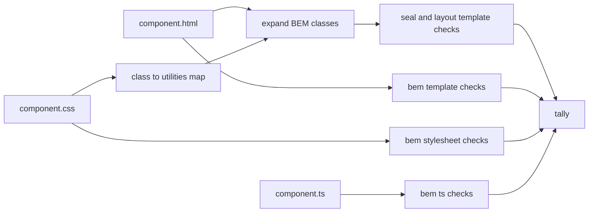
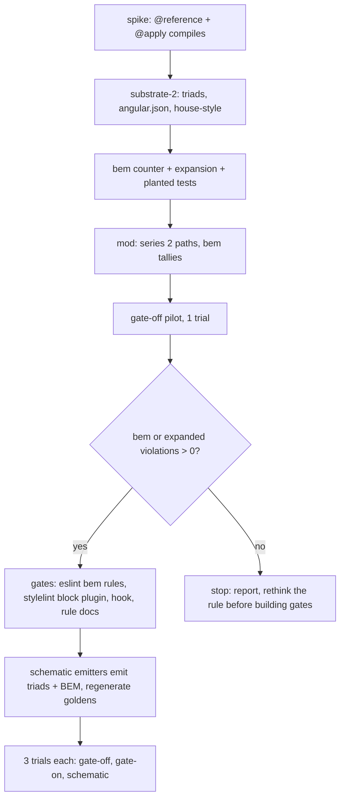

# BEM house style and schematic-arm series 2

Status: design, approved in conversation 2026-10-16. Supersedes the template half of the layout grammar in `layout-grammar-spec.md` for series 2 runs.

## Why

Schematic-arm series 1 (claude-haiku-5-5, house rules as of `main` 1bf3658) produced four valid runs, one gate-on pilot and three gate-off, and every counter read zero in all four. The `libs/` recount (`experiments/schematic-arm/libs-recount.md`) added nothing. The gates had nothing to stop.

The likely reason is that the series 1 rules describe what the model writes by default. Spartan primitives, semantic color tokens, `gap-*` over `space-*` and Tailwind utilities in the template are the shape of every shadcn and spartan example the model trained on. A rule that matches the model's prior is followed with or without enforcement, so it cannot tell the arms apart.

Series 2 adopts a house style that runs against that prior and that the owner holds for readability and maintainability: utilities live in component stylesheets through `@apply`, templates carry only BEM class names, and every component is three files. This gives each arm of the thesis a job. The schematic writes the shape (the file triad and the BEM block), the agent fills it, and the gates catch the fill drifting back to inline utilities.

Series 1 stays committed as the baseline: rules aligned with the prior need no enforcement.

## The rules

Each rule applies to authored code under `src/app`. `libs/ui` is spartan CLI output and is out of scope, as it is today.

### R1. Template classes are BEM only

Every token in a static `class` attribute, every class name bound through `[class.x]`, and every string literal inside a `[class]` binding expression, must be a BEM name: `block`, `block__element`, or `block--modifier`, or `block__element--modifier`, each segment lowercase kebab-case. No Tailwind utility appears in a template, including `sr-only`. There is no allowlist.

Helm directives and their inputs are not classes and stay as they are: `<button hlmBtn variant="ghost" size="icon" class="roster__retire">`.

### R2. A component uses exactly one block, named after itself

The block name is the component's file stem: `hero-card.ts` owns `.hero-card`, `.hero-card__name`, `.hero-card--retired`. A template class whose block is not the component's own is a violation (foreign block). A stylesheet selector that names a different block is a violation. `:host` is allowed and counts as the block.

### R3. Every component is a triad

Every `@Component` under `src/app` uses `templateUrl` and `styleUrl` and has the sibling `.html` and `.css` files with the same stem. `template:` and `styles:` are violations, with no exception for small components. A component whose template has no class to style still ships an empty-bodied stylesheet containing only the `@reference` line.

### R4. Stylesheets are plain CSS with nesting

Component stylesheets are `.css`, not `.scss`: Tailwind v4 states it is not designed to run behind Sass. Each starts with `@reference` to the theme stylesheet so `@apply` can resolve tokens and variants, and uses native nesting for elements and modifiers:

```css
@reference "../../styles.css";

.roster {
  @apply grid gap-6;
  &__filters { @apply flex flex-wrap items-center gap-3; }
  &__filter { @apply w-full sm:w-48; }
  &__label { @apply sr-only; }
}
```

### R5. Everything series 1 forbade in a template is still forbidden, wherever it now lives

Raw palette colors, `space-*` utilities, nested flex faking a grid, and appearance utilities on a primitive remain violations. They are now judged on the utilities a BEM class expands to (see Measurement), not on the template text. The no-raw-literals rule for hand-written CSS declarations is unchanged.

### R6. No Tailwind classes in TypeScript strings

Class strings in TypeScript under `src/app` (a `cva` variant, a `host: { class }` binding, a computed class string) are violations. This closes the blind spot the series 1 recount found, where the layout counter could not see utilities in a `cva` string.

All other house rules (the sealed control vocabulary, icons, composition, MVVM, forms, component shape, responsive correctness) carry over unchanged.

## Measurement

The counter is built first and gates nothing; it is the independent auditor every arm is scored by. A new `bem` family joins `seal`, `layout`, `shape` and `freeloader` in `harness/counter/`.

### Expansion

The central mechanism. For each component, the counter parses its `.css` with postcss, resolves nesting, and builds a map from each BEM class to the utilities its rules `@apply` (including utilities under nested pseudo-classes and variants on that class). It then rewrites a copy of the template, replacing each BEM class with its expansion, and runs the existing `seal` and `layout` template checks on the expanded copy. The existing rules, tests and fixtures are reused as they are; only their input changes.



### `bem` rules

| rule | fires on |
| --- | --- |
| `template-utility-class` | a template class token that is not a BEM name (R1) |
| `foreign-block` | a template class or a stylesheet selector whose block is not the component's file stem (R2) |
| `inline-template` | `template:` in a component under `src/app` (R3) |
| `inline-styles` | `styles:` in a component under `src/app` (R3) |
| `missing-triad` | a component without its sibling `.html` or `.css` (R3) |
| `missing-reference` | a component stylesheet with `@apply` but no `@reference` (R4) |
| `utility-in-ts` | a Tailwind class token inside a TypeScript string literal (R6) |

`utility-in-ts` uses a token classifier shared with `template-utility-class`, so the two cannot disagree about what a utility is.

### Baseline and planted checks

The converted substrate counts 0 on every family, in `src/` and on the per-violation difference in `libs/`. Each `bem` rule and each expanded `seal`/`layout` rule gets a dirty and a clean fixture, and a planted-violation test proves the counter sees each one where it now lives: `bg-red-500` in an `@apply` under a class on an `hlmBtn`, `space-x-2` in an `@apply`, a `cva` string, a foreign block, an inline template.

### What the driver records

The mod's finish step adds `bem` to `counterTotals` and writes `bem-tally.json` beside the others. Expanded `seal` and `layout` counts replace the template-text counts for series 2, and the meta records which mode produced them.

## Substrate changes

A new branch `substrate/schematic-arm-2` from `substrate/schematic-arm`:

1. Convert the placeholder screens (`dashboard`, `heroes`, `hero-detail`) and the shell (`app.ts` already has `app.html` and `app.css`) to triads that satisfy R1 to R4.
2. Set `angular.json` component schematic defaults to `inlineTemplate: false`, `inlineStyle: false`, `style: css`, so `ng g component` produces a triad.
3. Rewrite the house-style skill: a new "Markup is BEM, styling is in the stylesheet" section stating R1 to R6 with one worked example, and the layout grammar section restated in terms of what a class expands to. The skill states plainly that this overrides the spartan skill's examples, which put utilities in the `class` attribute. The vendored spartan skill is not edited: its pull toward inline utilities is the realistic pressure the gates are tested against.
4. Nothing under `harness/counter/`. As in series 1, the counters live on the launching branch (`research/schematic-arm`) and the mod measures with them after the run, so the subject never sees the counter.
5. Confirm first, before anything else is built on it, that `@reference` plus `@apply` with variants and theme tokens compiles in a component `.css` under the Angular builder with `@tailwindcss/postcss`. This is the one technical assumption the design rests on.

## Series 2 mechanics

- `arm.config.json` gains a `series` field (`2`) and points `substrate` at `substrate/schematic-arm-2`. Runs land in `experiments/schematic-arm/s2/<condition>/`, so series 1 evidence is untouched.
- The stage prompts are unchanged. The rules reach every arm through the house-style skill, identically, so the arms differ only in gates or schematic.
- Void reasons are unchanged. The tamper check extends to the new counter files through the existing `harness/` protection.

## Order of work

Approach B: the rule and the counter first, one gate-off pilot, then the rest.



The decision at the pilot is deliberately low: any violation means the gates have work to do. A gate-off pilot that writes clean BEM triads unprompted means the model follows this style too, and building gates for it would repeat series 1.

## After the pilot (phase 2, outline only)

Specified in detail in its own plan once the pilot result is in, because the pilot's violations decide which gates matter most.

- Gates: an eslint template plugin (`bem/no-utility-class`, `bem/no-foreign-block`), eslint TS rules (`bem/no-inline-template`, `bem/no-inline-styles`, `bem/no-utility-in-ts`), a stylelint plugin enforcing the file's own block on every selector, a PostToolUse hook registered only in gate-on, and a per-rule doc with an `## Agent guidance` section for each, following the existing `rule-docs.mjs` pattern.
- Schematic: the entity, form and manage emitters write triads with the block named after the component and the BEM element skeleton already in the template and the stylesheet, so the agent fills `@apply` bodies rather than inventing structure. All goldens regenerate; `verify:arrives-green` adds the `bem` counter at 0.
- The stripped subject-facing schematic branch and the mod changes from the series 1 plan carry over, retargeted at `substrate/schematic-arm-2`.

## Quality beyond the counters

Counters measure rule breaking. For the quality difference between arms, series 2 also records, per screen, the template element tree and the set of BEM element names, so trials in the same arm can be compared for repeatability (how many distinct structures three trials produce for the same screen). The blind rubric review and click-through defect count stay candidates, decided after the first full arm lands.

## Out of scope

- `libs/ui`, which stays generated spartan output.
- Editing the vendored spartan skill.
- The responsive auditor, which reads the rendered DOM and is unaffected by where classes are written.
- Any change to series 1 evidence.
