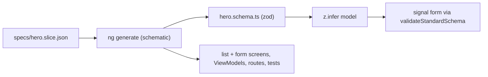
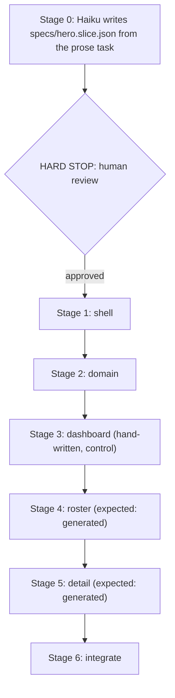

# The schematic spec

The written contract for the schematic arm. Read `capstone-spec.md` first: this file reuses its conditions, its counters, its model policy and its enforcement guard, and changes one thing about how the build is produced.

## The thesis this arm tests

**Schematics write the shape. Gates police the fill and the edits.**

The capstone measured two conditions, and both had Haiku writing every line by hand. Without gates the counters found 326 violations; with gates they found zero, and the gates cost 43 percent more spend and 24 percent more turns per build. The breakdown says where that cost went. 229 of the 326 were in the sealed vocabulary, which is fixed text a template would never get wrong. The extra spend landed on the template-heavy stages. Three of six builds compiled, passed every rule, and rendered a blank page because of dependency-injection wiring (an icon registered in the wrong injector, a ViewModel injected but not provided), which no AST rule can see.

All three findings come from the same thing: paying a model to produce structure the house has already decided, then paying again to correct it. A generator emits that structure as fixed text, so the correction never has to happen. The gates stay, but their job moves: they police the code the model still writes by hand (the fill, and every later edit), which is the place drift can still enter.

This arm exists to measure that claim instead of asserting it. If the schematic arm costs the same as gate-on and the gates fire just as often on the generated screens, the thesis is wrong, and this document is where that gets said.

## Decision 1: the generator is an Angular schematic in this repo

The generator is a local schematic collection, invoked through `ng generate`. This repo is Angular only, so a schematic is the native tool, and the design system already arrives this way: every spartan primitive in `libs/ui` was installed with `ng g @spartan-ng/cli:ui`. The schematic applies the same mechanism to the screen shape.

This differs from `jig`, whose slice generator is EJS templates driven by TypeScript, because its slice spans .NET, Rust and Angular and no single CLI owns all three. That reason does not apply here.

What the schematic emits for one entity, per admitted kind:

- the feature component, its template, and its ViewModel, with the ViewModel listed in the component's own `providers`;
- the route entry and the navigation entry;
- the zod schema, the `z.infer` model, and the signal form wired through `validateStandardSchema`, for the form kind;
- the unit tests for the ViewModel and the component.

Every emitted file uses the sealed vocabulary, registers its icons with `provideIcons` in the component that renders them, and passes the full ruleset on arrival. "Arrives green" means `npm run build`, `npm run lint`, `npm run lint:css`, the unit tests and the boot check all pass with no hand edits.

**A generated file that is wrong is a schematic bug.** Fix the schematic, add its test, and regenerate. Editing the generated file means the next entity reintroduces the defect. The tests are emitted with the code in one step; TDD applies to the schematic itself, which is built red-green-refactor against its own tests. This is the same position `jig` records in its ADR 0015, for the same reasons.

**The golden test.** One committed exemplar per admitted kind is the schematic's golden output. Every `verify` generates it in memory and fails on any byte that differs from the committed files. Without that test, someone adds a rule, updates the exemplar, forgets the schematic, and the schematic quietly starts emitting code that fails the new rule while every gate stays green. `jig` hit exactly this before its golden test existed.

## Decision 2: a fixed catalog of kinds, with a written bar

The schematic supports a small, fixed catalog of screen kinds. A kind is admitted only when all four of these hold:

1. **The shape has been hand-written at least twice**, under gates, and the copies are the same shape. The catalog generates what has been proven by hand, never what is expected to be needed.
2. **The spec for the kind is pure data.** No spec field accepts code, markup, a CSS value, or a template string. The spec is validated by a strict zod schema, so an unknown key fails. This is the part of the bar a machine enforces: the first free-form field (`customTemplate: string`, `extraMarkup`, anything of that shape) turns every kind into "this kind plus whatever was pasted in", which is a suppression dial one level up from `eslint-disable`.
3. **The kind ships with a golden exemplar** that passes the full gate on every `verify`.
4. **Admission is recorded in a decision note** next to this file, naming the two hand-written copies that satisfied rule 1. The catalog grows only on a recorded decision, never as a side effect of a PR that needed one more screen.

**The initial catalog is `list` and `form`.** The candidates that must satisfy rule 1 before admission are the existing list screens (`roster`, `missions`, `threats`) and the existing edit screens (`hero-detail` and the mission and threat details). Before the first kind is admitted, confirm the copies really share a shape and record which two satisfied the rule. If they do not share one, the kind is not admitted and this document is corrected.

**`dashboard` is out.** It has not been hand-written twice in one shape. It stays hand-written under gates, and that makes it the control screen inside every schematic-arm build.

## Decision 3: the spec is the single source, and the zod schema is emitted from it

The input is one JSON file per entity under `specs/`, for example `specs/hero.slice.json`. The zod schema for the form is **emitted from the spec**, never hand-written next to it. The house rule already says the zod schema is the single source of truth for a form; a hand-written schema beside a spec would be a second source of the same fields, and two sources drift.

The chain is one direction only:



A sketch of the spec, to make the idea concrete. The strict zod schema that validates it, not this example, is the authority on its shape:

```json
{
  "entity": "Hero",
  "plural": "heroes",
  "icon": "lucideShield",
  "kinds": ["list", "form"],
  "fields": [
    { "name": "name", "type": "string", "required": true, "label": "Name" },
    { "name": "rating", "type": "number", "required": true, "label": "Rating" },
    { "name": "active", "type": "boolean", "required": false, "label": "Active" }
  ],
  "list": { "columns": ["name", "rating", "active"], "sortBy": "name" }
}
```

## Decision 4: the agent writes the spec, a human approves it, and the diff is reported

The schematic is deterministic given a spec. Who writes the spec decides whether "deterministic" is true or only nearly true, so it is decided here.

**Haiku writes the spec from the prose task. A human reviews and approves it before anything is generated.** Strict zod catches a malformed spec, not a wrong one: a spec missing a field the screen needed validates and generates perfectly. The review is the only thing that catches that, so the review is part of the process, not an optional courtesy.

The review has a cost, and leaving it out of the report would flatter the arm. For every trial the evidence keeps:

- `spec.proposed.json`, the spec exactly as Haiku wrote it;
- `spec.approved.json`, the spec as approved;
- `spec.diff`, the difference, plus the count of fields changed and the minutes the review took.

A spec approved unchanged three times is a finding. A spec whose field list is rewritten every time is a different finding: it means the bottleneck moved upstream into the spec.

The claim the article makes is **"deterministic from an approved spec"**, never "deterministic" alone.

## The experiment

### Conditions

Two conditions, run in the same week on the same model id and the same ruleset:

- **gate-on (rerun)**: the capstone's gate-on condition, rerun under the current 27-rule ruleset. The original capstone numbers were produced under an older ruleset (before `unregistered-icon` and the boot gate existed), so comparing a new arm against them would mix two variables. The original numbers stay in the record as history.
- **schematic**: identical to gate-on, plus three things present in the tree: the schematic, a skill that tells the agent when to use it, and the approved spec.

The variable is "schematic, skill and approved spec present". Everything else is held constant: the stage list, the stage prompts, the hooks, the counters and the model.

**The stage prompts for the roster and detail screens are unchanged from gate-on.** The prompts do not say "run the schematic". The agent has to recognize from the skill that a spec-shaped screen should be generated. If it hand-writes the roster instead, the skill's routing failed, and that is reported as a finding rather than corrected by rewording the prompt. A generator nobody reaches for has the same problem as the orphaned recipe in `jig` PR #19.

### Stages



Stage 0 exits after writing the spec. Nothing is generated in the same process. A headless run that flows straight through has not been reviewed, whatever its configuration says. The driver refuses to start stage 1 until `spec.approved.json` exists.

The gate-on rerun uses the same stages 1 to 6 with no stage 0.

The capstone driver (`harness/driver/run-capstone.mjs`, `capstone-stages.mjs`) was removed from the tree in `fc4e801` when the repo was prepared for a public reader. It is restored from that commit's parent and extended with stage 0 and the stop, rather than rewritten.

### Measurements

Per trial, in both conditions:

- spend, turns and duration per stage, summed into a run total from measured numbers only (the capstone's `cost.json` ledger, unchanged);
- every counter the capstone runs, **reported per screen**, so the generated screens and the hand-written dashboard can be compared inside one build;
- gate firings per screen, from `hook-firings.jsonl`;
- whether the app boots to a rendered screen on every route. The boot check runs as a measurement after the run in both conditions, not as a hook during it, so it cannot steer one arm and not the other;
- whether the agent invoked the schematic for roster and detail, or wrote them by hand;
- in the schematic arm only, the spec review record from Decision 4.

**The coverage line is mandatory in any report:** how many of the app's screens were generated, and what share of the built code (by line count of `src/app`) came from the schematic. Tour of Heroes is mostly CRUD, so the schematic will cover much of it. Leaving that number out makes a real result look rigged.

### What would falsify the thesis

- Gate firings on the generated screens are close to the gate-on rerun's firings on the same screens. The schematic is not doing the creation work.
- Total spend in the schematic arm, including stage 0, is not lower than the gate-on rerun. The tokenomics half of the thesis fails.
- Generated screens fail the boot check. The schematic did not remove the wiring failures it exists to remove.
- The agent hand-writes the roster or detail in two or more of three trials. The mechanism works but is not reachable, which is a smaller and different claim.

Each of these gets reported as it happens. None of them is fixed by rewording a prompt between trials.

## The model policy

Unchanged from the capstone. Haiku is the subject in every stage, including stage 0. The schematic, its tests, the spec schema, the golden exemplars, the skill, the driver changes and every review are built on a capable model, because they are the instrument. A subtle bug in the schematic, written by the model under test, would invalidate every number this arm produces.

## The enforcement guard covers the schematic

`.claude/hooks/protect-enforcement.mjs` and the driver's changed-file check add the schematic collection, the spec schema and the golden exemplars to the protected paths, in both conditions. The `stylelint.config.mjs` episode showed that the agent will edit whatever stands between it and a passing build. If the agent edits the schematic to make its output pass, the experiment is measuring an agent-modified generator. A trial that touches those paths is void.

`specs/` is the one exception and is not protected: stage 0 has to write there. After the human stop, the driver diffs `specs/` against `spec.approved.json`, and a trial whose spec changed after approval is void.

## The honest asymmetries

1. **The human review is not blind.** The reviewer knows which arm they are in. This is accepted because the review exists only in the schematic arm, but it means review time and spec diffs are one person's numbers, not a general rate.
2. **Three trials per condition.** As in every Part. The direction of a result at n=3 is credible; its precision is not.
3. **The catalog is small on purpose, and that limits the claim.** The result says what generation buys on list and form screens. It says nothing about kinds that have not been admitted, and the dashboard result is about hand-written code under gates, not about generating dashboards.
4. **The schematic encodes this repo's shape.** A different house, with different rules, needs a different schematic. The method transfers; the templates do not.

## Build order

1. Confirm rule 1 for `list` and `form` against the existing screens, and write the two admission notes.
2. The strict zod schema for the spec, red-green-refactor.
3. `specs/hero.slice.json`, written by hand as the reference. If the roster and the detail screen cannot be expressed in it without a free-form field, stop: the spec design is wrong.
4. The schematic, one kind at a time, with its golden exemplar and the golden test in `verify`.
5. The skill that routes the agent to the schematic.
6. Restore and extend the driver: stage 0, the hard stop, the spec diff, per-screen counter output, and the post-run boot check.
7. The gate-on rerun, three trials, then the schematic arm, three trials.
